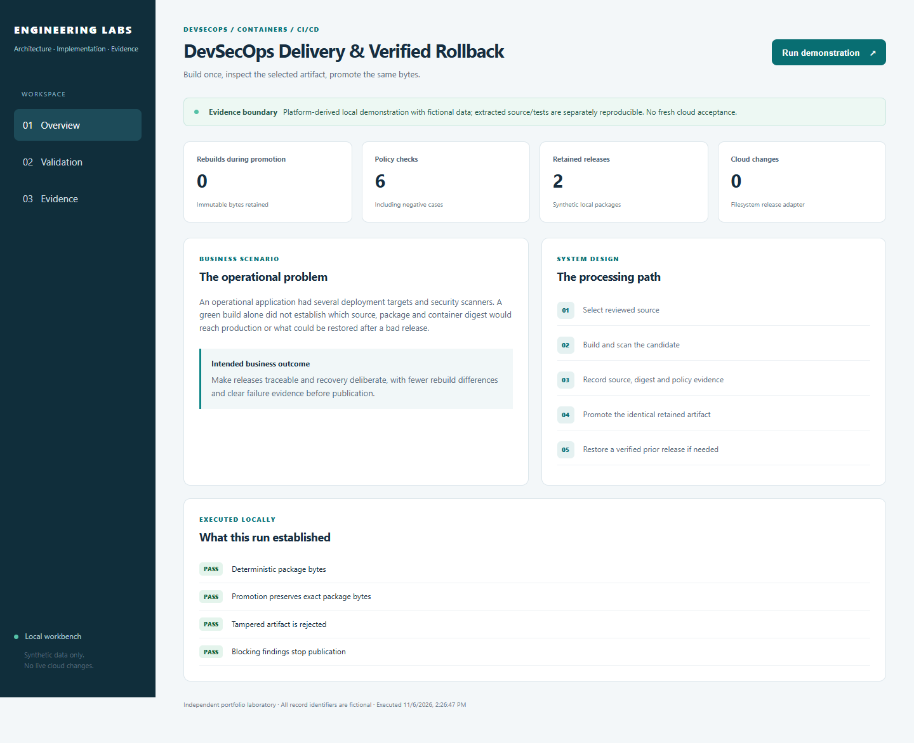
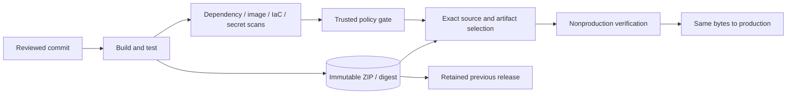
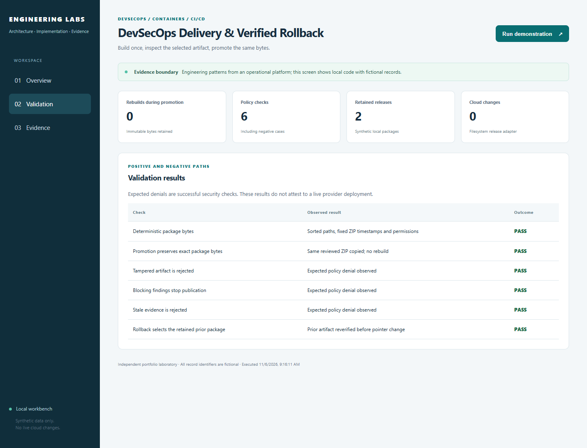

# DevSecOps Delivery & Verified Rollback

**Build once, inspect the selected artifact, promote the same bytes.**

[The problem](#the-business-problem) · [The solution](#the-solution) · [What was built](#what-was-built) · [Proof it works](#proof-it-works) · [Run it](#run-it-locally)



## The Business Problem

An operational application had several deployment targets and security scanners. A green build alone did not establish which source, package and container digest would reach production or what could be restored after a bad release.

1. **Different bytes at release time.** Rebuilding during promotion can produce a different package from the one that passed testing.
2. **Security reports without a binding.** A report is not useful release evidence if it belongs to another source, artifact or expired policy window.
3. **Recovery by guesswork.** A previous branch is not the same thing as a retained, verified rollback package.

## The Solution

Build once, retain the package with its source and digest, check the selected evidence before promotion, and restore a verified prior artifact when recovery is needed. Keep registry publishing trust separate from application runtime access.

**Business goal:** Make releases traceable and recovery deliberate, with fewer rebuild differences and clear failure evidence before publication.

### Platform implementation

- Built API/web artifact archives, exact-hash preflights and paired promotion so production used the verified packages instead of a new build.
- Added release and rollback checks for exact selected source, retained artifacts, settings preservation and cleanup of temporary release infrastructure.
- Integrated dependency, container, IaC and secret scanning with dated findings, package inventories and remediation evidence; separated report generation from release authorization.
- Patched vulnerable dependencies using compatible versions and consumer regression tests, retaining unresolved findings rather than claiming a clean estate.

This case study draws on a workforce/operations platform I designed and implemented. Organization details and records are excluded. The public code makes selected patterns reproducible; the screenshots show a working local demonstration with fictional data. [Validation scope](docs/VALIDATION.md) separates that evidence from provider-side acceptance.

## Architecture



## What Was Built

| Component | Role in plain words | Implementation |
| --- | --- | --- |
| Deterministic package builder | Sort paths and fix ZIP metadata so identical inputs produce identical bytes. | [View code](lab/domain.py) |
| Selected-artifact policy gate | Reject modified bytes, wrong-source evidence, incomplete scans and blocking findings. | [View code](lab/domain.py) |
| Content-addressed release archive | Retain packages and change a small atomic release pointer instead of rebuilding. | [View code](lab/domain.py) |
| ACR and repository-scoped publisher | Keep registry admin credentials Off and scope optional OIDC publishing to one repository. | [View code](infra/registry.tf) |
| Private artifact storage | Use keyless, versioned archive storage with deletion protection. | [View code](infra/storage.tf) |
| Container example | Run the local demonstration as non-root in a digest-pinned Python image. | [View code](Dockerfile) |

## Proof It Works

**Recorded checks:** 12 unit tests passed · 6 demonstration checks passed · 2 Terraform mock tests passed.

These are dated results for this reference implementation, not live Azure/AWS deployment claims. [Test record](docs/validation-results.json) · [Evidence and limitations](docs/VALIDATION.md)

### 1. Promotion preserves the selected bytes

The local test compares the promoted package against the original. Changed bytes and stale/incomplete evidence fail before publication.

### 2. Rollback uses the retained prior package

The demonstration re-verifies a previous archive and selects its digest. It does not rebuild the old source.

### 3. The container runs under restrictions

The recorded Linux ARM64 smoke used a non-root user, no network, a read-only filesystem and dropped capabilities. This was a runtime test, not a vulnerability scan of that demonstration image.

### 4. Visible results

The dashboard runs the same domain code as the CLI. Desktop/mobile rendering, all three tabs, rerunning the demonstration, cross-origin write rejection and unlisted-file rejection were checked. The screenshots are captured from those runs.



Expected access denials are successful negative tests. Cloud permissions, network connectivity and provider integrations need their own acceptance evidence.

## Security Practices

- The local policy receipt is synthetic. A real release needs independently trusted scanner evidence and source-to-artifact binding.
- ACR admin credentials and storage shared keys are Off. The optional publisher uses an exact reviewed OIDC subject and repository ABAC condition.
- Trivy, Checkov, TruffleHog and ZAP have different coverage. Remaining findings stay visible; a digest or green build alone does not establish safety.

State, saved Terraform plans, private inputs and credentials are excluded through [`.gitignore`](.gitignore). The existing validation workflow is manual-only and has no cloud deployment permission.

## Run It Locally

Requires Python 3.12 or newer. The default demonstration uses the Python standard library. Run inside a virtual environment:

```bash
python -m venv .venv
source .venv/bin/activate
python -m pip install -r requirements.txt
python -B -m unittest discover -s tests -v
python -B -m lab demo
python -B -m lab serve --port 8011
```

On Windows, use `.venv\Scripts\Activate.ps1` instead of the `source` command, or run `.venv\Scripts\python.exe` directly. Open [the local workbench](http://127.0.0.1:8011), choose **Run demonstration**, then review **Validation** and **Evidence**. Stop with Ctrl+C. No cloud login, employee data or paid API request is required.

## Terraform Infrastructure

A shared-style ACR registry, keyless private release-archive storage with version protection, and an opt-in repository-scoped OIDC publisher.

See the [Terraform code and validation steps](infra/README.md), [input example](infra/example.tfvars.example) and [mock plan tests](infra/tests). Cloud commissioning and any paid resources remain separate from the local demonstration.

Validate the infrastructure source without creating cloud resources:

```bash
cd infra
terraform init -backend=false
terraform fmt -check -recursive
terraform validate
terraform test
```

The tests use mock providers. Example inputs are placeholders, not deployment-ready values. Review the [integration boundaries and cost notes](infra/README.md) before any separate cloud commissioning.

## Scaling and Tradeoffs

Separate build, scan, select and publish responsibilities. Retain verified release pairs and referenced images, use trusted signing/provenance checks and avoid repeating successful jobs when only one stage fails.

See [strengths, weaknesses and tradeoffs](docs/SCALING.md) for the detailed decisions.

## Skills Demonstrated

- GitHub Actions and artifact promotion
- Container packaging and runtime restrictions
- Vulnerability/secret/IaC scan integration
- OIDC and repository-scoped publishing
- Verified rollback and release traceability

## Project Guides

| Guide | What you will find |
| --- | --- |
| [Implementation walkthrough](docs/WALKTHROUGH.md) | Follow the processing path and code |
| [Architecture](docs/ARCHITECTURE.md) | Understand service and identity boundaries |
| [Terraform](infra/README.md) | Read the resource map, input examples and integration steps |
| [Validation evidence](docs/VALIDATION.md) | Inspect dated checks and their limits |
| [Operations and troubleshooting](docs/OPERATIONS.md) | Diagnose failures and recover safely |
| [Security and privacy](SECURITY.md) | Review access, secrets and publication controls |
| [Scaling and tradeoffs](docs/SCALING.md) | Understand the costs of each design choice |
| [References](docs/REFERENCES.md) | See technical sources and presentation inspiration |

## Repository Map

```text
infra/               Terraform source, example inputs and mock plan tests
lab/                 Working reference implementation and loopback dashboard
tests/               Positive, negative and recovery cases
docs/                Architecture, walkthrough, evidence and operating guide
.github/workflows/   Manual-only contract validation; no cloud deployment
```

## Cost and Cleanup

The default local demo creates only temporary local state and makes no paid calls. Cloud examples are separate opt-in source and can create billable resources if an operator applies them. No automated deployment or destruction is configured. Use `git status --short --ignored` before cleanup; remove only your own `.venv` or disposable lab output. Never copy real state files, tokens or employee documents into this repository.
