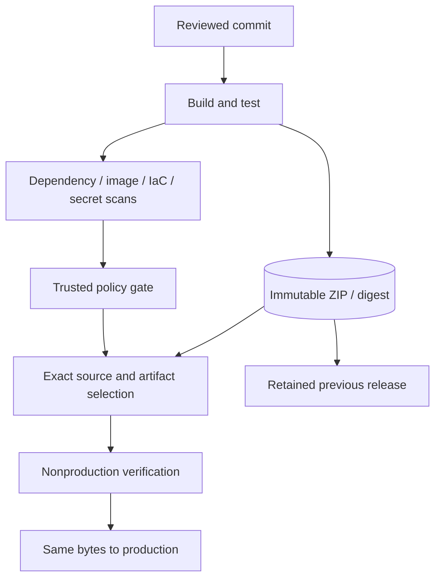

# Architecture and implementation boundaries

## Source-platform context

An operational application had several deployment targets and security scanners. A green build alone did not establish which source, package and container digest would reach production or what could be restored after a bad release.

- Built API/web artifact archives, exact-hash preflights and paired promotion so production used the verified packages instead of a new build.
- Added release and rollback checks for exact selected source, retained artifacts, settings preservation and cleanup of temporary release infrastructure.
- Integrated dependency, container, IaC and secret scanning with dated findings, package inventories and remediation evidence; separated report generation from release authorization.
- Patched vulnerable dependencies using compatible versions and consumer regression tests, retaining unresolved findings rather than claiming a clean estate.

## Processing path

## Portable reference boundary

This repository keeps the decision logic small enough to inspect and run. SQLite, temporary files and modeled network decisions replace cloud-side resources where stated. No production identifiers or original employee records are included. The browser dashboard is a loopback-only demonstration, not a hosted multi-user application.

The public implementation borrows the source platform's responsibilities and failure lessons. It does not claim byte-for-byte equality with the Node.js/Azure implementation. Changes of language or backing store are explicitly reference adaptations.

## Trust boundaries

1. Treat user input, scan events and imported files as untrusted data.
2. Validate identity, resource ownership and exact source/version before changing state.
3. Keep privileged workers and deployment identities separate from business API permissions.
4. Preserve failed and unknown outcomes; do not turn absence of evidence into a success.
5. Keep secrets in a managed secret store or local environment, never in Git or screenshots.

## Before a hosted deployment

Review the caller matrix, identity permissions, durable state, concurrency, log redaction and recovery path. Run actual provider integration tests in an isolated environment. Separately review cost, data retention, DNS and rollback. The manual CI validates local contracts only and has no cloud identity or deployment permission.

## Included Terraform

A shared-style ACR registry, keyless private release-archive storage with version protection, and an opt-in repository-scoped OIDC publisher. See [the code map, resource inventory and integration boundaries](../infra/README.md). This public root does not provision every box in the application diagram.
